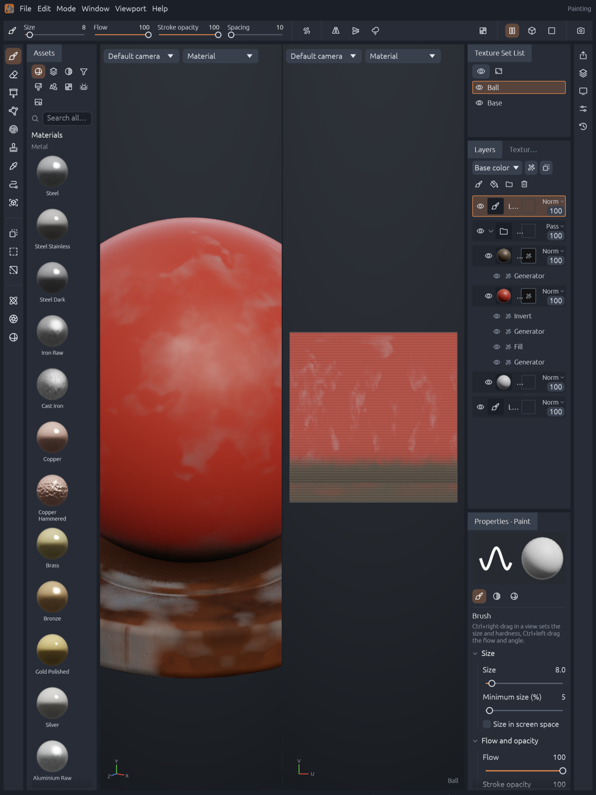

# TextureCraft for iPadOS (fork)

<p align="center">
  
  <br>
  <sub>TextureCraft on iPadOS (iPad Air 13-inch simulator). The app supports every orientation.</sub>
</p>

This fork exists only for the **iPadOS port** of TextureCraft, an open-source, clean-room 3D texture
painting app written in Rust. To learn about the project itself (features, file formats, desktop and
web builds, downloads, the other Crafting Apps, contributing), read the upstream README:
**[storytold/texturecraft](https://github.com/storytold/texturecraft#readme)**.

## What this fork adds

- **`apps/texturecraft-ios`**: a Rust static-library runner (UIKit single-scene delegate, Metal-only
  wgpu surface, safe-area insets taken from UIKit every frame, preferences in the app container,
  file dialogs through the native document picker, Apple Pencil identity and double-tap). See its
  [README](apps/texturecraft-ios/README.md).
- **Touch and Apple Pencil in the shell**: two-finger pan and pinch zoom in both viewports, strokes
  driven by the pen rather than the first finger on the glass (so a resting palm neither orbits the
  camera nor paints), real pressure on the pen and full pressure on a finger, and a pencil
  double-tap that swaps Paint and Eraser.
- **`packaging/ios`**: the Xcode project that links the library into an iPad app bundle, with a
  bundle validator and tests. See its [README](packaging/ios/README.md).
- **`cargo xtask ios`**: build, install and launch on the Simulator or a physical iPad
  (`--sim`, `--device --device-id <id> --team <id> [--bundle-id <dev id>]`).
- **A platform seam for file I/O**: the egui shell used to call `rfd` directly, which has no iOS
  backend. Dialogs now go through `texturecraft_ui_egui::services`, so the desktop keeps `rfd`, the
  browser keeps the File System Access picker, and iPadOS uses UIKit pickers injected by the runner.

## Status

Runs on the iPad simulator with Metal: the sample project opens, the editor lays out inside the
safe area, and the pickers present. Touch navigation and the Pencil bridge are implemented and
covered by host tests for the pen-identity logic, but the on-glass behaviour — pressure, palm
rejection before the pen, the double-tap swap — still needs an iPad with an Apple Pencil; see the
checklist in [`apps/texturecraft-ios/README.md`](apps/texturecraft-ios/README.md). Write-back to a
provider file, opening a document shared from Files, and multiwindow ownership are follow-up
tickets. This is not a hardware sign-off.

## Build and run

Requires macOS with Xcode and the Rust targets `aarch64-apple-ios`, `aarch64-apple-ios-sim` and
`x86_64-apple-ios`.

```sh
cargo xtask ios --sim          # build, boot, install and launch on the iPad simulator
cargo xtask ios --device --device-id <udid> --team <team id> --bundle-id <your.dev.bundle.id>
cargo test -p texturecraft-ios --lib
python3 -m unittest discover -s packaging/ios/tests -v
cargo xtask layers             # the runner is registered as an app-level crate
```

Contributor rules (Rust only, never panic, layering, clean-room, assets) are in
[`AGENTS.md`](AGENTS.md).

## License and attribution

Dual-licensed MIT OR Apache-2.0, as upstream. Third-party and original assets are listed in
[`ATTRIBUTION.md`](ATTRIBUTION.md).
